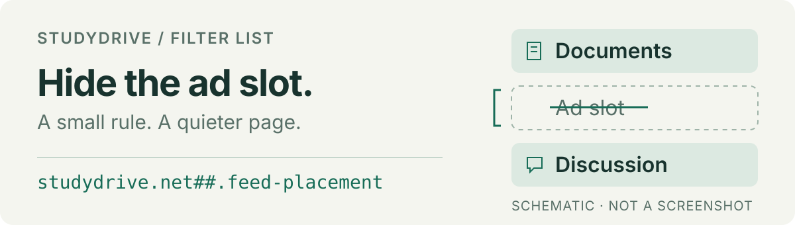

# Studydrive Adblock Filters

One small filter list for Studydrive ads, anti-adblock banners and Premium prompts. Subscribe with your content blocker; no extra extension from this project is needed.

[Install](#install) · [Compatibility](#compatibility) · [Report a problem](https://github.com/Skriipt/studydrive-adblock-filters/issues/new/choose) · [Maintenance](docs/maintenance.md)

<p>
  
</p>

The list blocks Google ad delivery on Studydrive, hides inline ads and selected dashboard promotions, and uses two ad-frequency cookies to prevent document fullscreen ads. **It does not unlock Premium or change download rights.** The sidebar Premium link stays available.

## Install

Copy this subscription URL, then follow the steps for your blocker:

```text
https://raw.githubusercontent.com/Skriipt/studydrive-adblock-filters/main/studydrive-ublock.txt
```

A URL subscription receives updates according to your blocker's settings. Pasting rules manually does not.

### uBlock Origin Lite

**Enable user scripts before adding the list.**

1. Open `chrome://extensions` or `edge://extensions`. Under **uBlock Origin Lite → Details**, turn on **Allow user scripts**.
2. In the uBO Lite dashboard, open **Filter lists → Add filter list…**.
3. Paste the URL above and click **Add**. Check that it appears under **Imported lists**.
4. Fully reload Studydrive: **Ctrl+Shift+R**, or **Cmd+Shift+R** on macOS.

Use **Add filter list…**, not **Custom filters → Import / Export**, which only accepts cosmetic filters. If the field is missing, update uBO Lite. [Why the permission is needed](https://github.com/uBlockOrigin/uBOL-home/wiki/Justification-for-the-declared-permissions#userscripts).

<details>
<summary>Already added the list, but banners still appear?</summary>

Remove it from **Imported lists**, enable **Allow user scripts**, add the same URL again and fully reload. In the earlier user test, granting the permission afterwards was not enough; re-adding the list fixed it.

</details>

### uBlock Origin

1. Open the dashboard and select **Filter lists**.
2. Under **Custom**, enable **Import…**, paste the URL and click **Apply changes**.
3. Fully reload Studydrive.

For a one-off local test, paste the contents of [`studydrive-ublock.txt`](studydrive-ublock.txt) into **My filters**, enable **Enable my custom filters** and apply. Remember that pasted rules do not update automatically. [Filter-list documentation](https://github.com/gorhill/uBlock/wiki/Dashboard:-Filter-lists).

<details>
<summary>AdGuard Browser Extension — setup, not yet verified with this list</summary>

1. If the MV3 extension requests **Allow User Scripts**, enable it first.
2. Open **Settings → Filters → Custom**, enable the group if needed, then **Add custom filter**.
3. Paste the subscription URL, click **Next**, confirm it is enabled and fully reload Studydrive.

[Custom-filter documentation](https://kb.adguard.com/kb/adguard-browser-extension/features/filters/) · [Scriptlet compatibility](https://github.com/AdguardTeam/Scriptlets/blob/master/wiki/compatibility-table.md)

</details>

## Compatibility

| Blocker | Evidence |
| --- | --- |
| uBlock Origin | Tested and works |
| uBlock Origin Lite | Tested and works |
| AdGuard | Installation documented; list-specific testing pending |

The current revision has automated desktop/mobile CSS tests and checks against public Studydrive source code. **Those checks do not replace an authenticated test with the actual extension.** Live guest observations remain inconclusive. Exact environments and limits are recorded in [maintenance](docs/maintenance.md#compatibility-evidence).

## What happens when Studydrive changes?

The rules use component structure and dedicated ad identifiers rather than spacing classes. Independent slot-ID and banner-image rules provide additional coverage. They cannot adapt to every redesign: an unknown layout may leave a banner or empty space visible.

The document fullscreen fix also depends on Studydrive's cookie logic. It resets on a full page load; navigation within the site consumes a large but finite counter. The list does not broadly hide dialogs or force scrolling, which could interfere with normal controls.

If an ad returns or useful content disappears, [report the page type, browser/blocker versions and reproduction steps](https://github.com/Skriipt/studydrive-adblock-filters/issues/new/choose). Please redact personal information and never attach cookies or login exports.

## Remove the list

Remove or disable the subscription and reload Studydrive. To also reset the fullscreen-ad state, delete only **`sd_fp_docs_left`** and **`sd_fp_until`** for `studydrive.net`. Clearing all site data also signs you out.

## For maintainers

Subscribers only need the text file. To work on the list, use Node.js 22+:

```sh
npm ci --ignore-scripts
npx playwright install chromium
npm test
```

`npm run check:upstream` checks current source markers. `npm run check:live` records separate CSS observations for the expected components; empty slots, missing banners and unavailable views cannot establish success. Neither command publishes changes.

[Rule evidence and maintenance guide](docs/maintenance.md) · [Changelog](CHANGELOG.md)

---

Looking for a separate tool to save an already loaded document preview? See [Studydrive PDF Downloader](https://github.com/Skriipt/studydrive-pdfdownloader). It may save fewer pages than the original; neither project requires the other.

[MIT license](LICENSE). Independent project; not affiliated with or endorsed by Studydrive.
